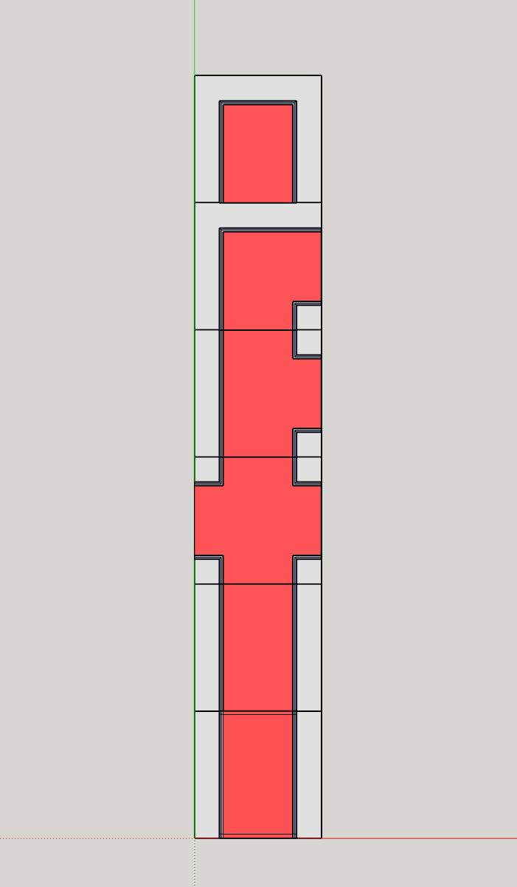
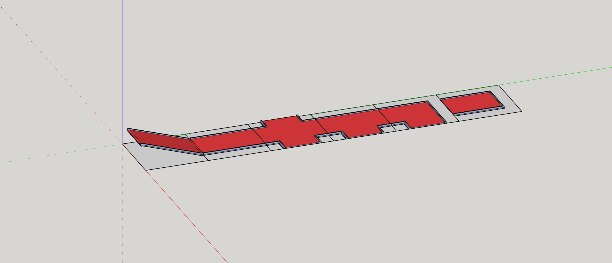

# Pixelwars

A team tile-coverage game played on a procedurally generated 3D maze, built for Decentraland with SDK7.

**Pixelwars** — two teams (Red and Blue) run around a fresh maze every round, painting the walkable surface in their color just by walking on it. Highest coverage at the round timer wins. Inspired by Splatoon's *Turf War*.

**Pixelwars** — the arena underneath. Every round a new layout is grown from a small set of modular tile pieces (corridors, forks, crossings, ramps). The round seed is shared so every player sees the same layout. Two level modes exist (`LEVEL_MODE` in [`src/maze/level.ts`](src/maze/level.ts)):

- **`classic`** (what `main` / the live world runs): a 5×5 tile maze on an 11×11 parcel world (176 m), centre spawn, ground level.
- **`sky`** (branch `level`, not yet playtested in-world or deployed): a 5×5 tile woven network (asymmetric but fairness-checked) floating at y 32 on a 20×20 parcel world (320 m), grid at 80–240 m, three levels, 1-tile team bases in opposite corners. See [Sky mode](#sky-mode-branch-level) below.

**Multiplayer:** authoritative headless server (`authoritativeMultiplayer: true`) owns the paint state and round clock; clients render and stream paint ticks at 10 Hz, server broadcasts deltas at 5 Hz.

**Live:** [pixelwars.dcl.eth](https://play.decentraland.org/?realm=pixelwars.dcl.eth)

The scene is intended to be **downloaded, remixed, and shared**. All source assets (Blender, SketchUp) are included alongside the exported `.glb` tiles so you can swap in your own geometry and generate entirely new worlds from the same rule set. See [`design/gdd.md`](design/gdd.md) for the game design doc (or [`design/gdd-summary.md`](design/gdd-summary.md) for a one-page overview). Older plans live in [`archive/`](archive/README.md).

---

## Status: V0 live · V1 in progress · sky level on branch `level` (untested in-world)

### V0 — vertical slice (live, classic mode)

- **Procedural maze regen every round** — new seed on each 5-minute UTC boundary; every player sees the same maze.
- **Paint pipeline** — a 3×3 footprint flips to your team colour as you walk; enemy paint flips back.
- **Authoritative server** — owns paint state, round clock, roster; clients send paint ticks at 10 Hz, server broadcasts deltas at 5 Hz.
- **Auto team assignment + drop-in / drop-out**, ghost bot for solo play, synced leaderboard + end-of-round banner, mobile-first HUD.

### Since V0 (on `main` at `956f79b`, merged before the `level` branch)

- **SDK upgrade** to the auth-server build (`@dcl/sdk` 7.30.2-…ee06955).
- **Team balancing + red/blue name tags** (roster broadcast drives client tags).
- **Faster on own paint** — 1.3× jog/run via `AvatarLocomotionSettings` (`OWN_PAINT_SPEED_MULT`).
- **Personal round contribution** on the end-of-round banner (`roundResult`).
- **Join retry** — the client re-sends `joinRoster` every 2 s until `teamAssigned` arrives (first join used to lose its team: no paint, no tag).
- **Chunked paint messages** — `paintDelta` / snapshot split into ≤200-change messages.
- Ramp paint offset experiments were tried and reverted; the original ramp paint code is the confirmed-good one.

### Branch `level` (ahead of `main`; not playtested in-world, not deployed)

Sky level mode, seeded woven generator, corner bases, teleporters, ghost-on-opposite-base, overview camera, fall respawn, and 250-seed verify scripts. Details below and in [`docs/HANDOFF.md`](docs/HANDOFF.md).

### V1 — planned (4-week scope)

See [`design/gdd.md`](design/gdd.md) §9. Week 1–2 items above (balance, name tags, own-paint speed, contribution) are built; Paint Bomb, skins/block remodel and the playtest/balance week are still open.

---

## Design references

| Plan view | Axonometric |
|---|---|
|  |  |

---

## How it works

### The tile catalog

Six modular tiles, each defined by a set of open edges in a canonical orientation (N/E/S/W). The generator considers all 4 rotations of each tile at every cell.

| Tile | Openings | Purpose |
|---|---|---|
| `end` | N | Seed / cap for dead ends |
| `straight` | N, S | Corridor |
| `turn` | N, E | 90° corner |
| `fork` | N, S, W | T‑junction |
| `cross` | N, E, S, W | 4‑way intersection |
| `ramp` | N, S | Two‑level connector (S is low, N is high) |

Source models live in [`assets/models/`](assets/models/) as `.glb` files. Original modeling files:

- [`assets/blender/tiles.blend`](assets/blender/) — Blender source
- [`assets/sketchup/tiles.skp`](assets/sketchup/) — SketchUp source

### Generation algorithm (classic mode)

Maze growth is a frontier‑based flood‑fill with vertical stacking:

1. **Seed** — about 1 seed per 25 parcels are dropped as `end` tiles at random cells on the ground level.
2. **Grow** — the open edges of placed tiles feed a frontier queue. Cells are consumed lowest‑Y first (so each floor fills horizontally before ramps climb).
3. **Pick a tile** — a weighted pool favours branching/ramp tiles (`ramp ×3, cross ×2, fork ×2, turn, straight`), falling back to `end` only when nothing else fits.
4. **Validate placement** — each candidate must pass strict connectivity checks: openings can't face off‑grid or into a wall, ramps can't collide vertically, and multi‑level ramp interactions must "handshake" correctly (see `canPlace()` in [`src/maze/generator.ts`](src/maze/generator.ts)).
5. **Validate result** — after growth, every opening on every placed tile must connect to a matching neighbour. If any dangle, discard and retry with a new seed (up to 500 attempts).

Ramps are the tricky part. Because a ramp's high side lands one level up in an adjacent cell, they interact with neighbours on multiple Y levels simultaneously. The generator enforces several rules to keep stairs walkable:

- Cells directly above a ramp must be empty or another ramp of the **same rotation**.
- Parallel same‑axis ramps on different levels must climb in the **same direction** (no fragile "V" configurations).
- When two orthogonally‑adjacent ramps interact, either their rotations match (matched handshake) or they meet edge‑to‑edge at their shared high edges.

Generation is deterministic given a seed: the RNG is a small mulberry32, and the winning seed is logged to the browser console on each generation so any bug can be reproduced exactly.

### Sky mode (branch `level`)

Switch: `LEVEL_MODE = 'sky'` in `src/maze/level.ts` (current on `level`). Key numbers:

| Thing | Value |
|---|---|
| World | 20×20 parcels (320 m), `scene.json` |
| Grid | 5×5 tiles of 32 m over x/z 80–240 m (`SKY_EDGE_INSET = 80`) |
| Levels | L-1 21.233, L0 32 (`SKY_ALTITUDE`), L+1 42.767 — ramp rise `STEP` 10.767 m |
| Bases | 1 team-locked `turn` tile each: RED (0,0) opening N+E, BLUE (4,4) opening S+W, same every round |
| Spawns | RED (96, 33.5, 96), BLUE (224, 33.5, 224) at the base tile centres, facing the centre (160, 33.5, 160); `scene.json` ranges 94–98 / 222–226 |
| Symmetry | `SKY_SYMMETRIC = false`: asymmetric layouts held to a fairness check (true = 180° rotation of tiles, heights, openings) |

**Generator** (`layBaseLine()` / `netAttempt()` in `src/maze/generator.ts`), seeded from the round seed:

1. Height field: L0 everywhere, 2–3 random rectangles raised to L+1 and 2–3 sunk to L-1 (1–2 wide below 6×6), each with its 180° image when symmetric; bases and their exit cells stay L0.
2. Ramps where the level steps by one along a line (±1 only, never orthogonally adjacent, flat tiles at both ends), placed in mirrored pairs when symmetric.
3. Link every same-level flat neighbour pair; ramps link only their two ends; base exits are fixed.
4. Prune to the 2-core (no dead ends), keep the component holding both bases.
5. Thin random links (mirrored pairs when symmetric) (up to 25%) while staying connected with no dead ends.
6. Tiles from openings (straight / turn / fork / cross); ramp r = high side. Check with `validate()`, full connectivity and symmetry (or the fairness check).

Best of 6 valid candidates (all three levels used, junctions ≥ 12 × size scale: 4 on 5×5, 7 on 6×6, ≥70% coverage, a valid teleporter pair, fair) by junction / ramp / coverage score with random jitter; up to 1500 attempts, else the frozen fallback for that grid size (`FALLBACKS['5x5']` / `['6x6']`).

**Symmetry flag and fairness:** `SKY_SYMMETRIC` in `level.ts` (default **false**). When it's true, layouts are 180° images of themselves and the teleporter is A ↔ mirror(A). When it's false, layouts are asymmetric but must pass a **fairness check** (`fairness()` / `FAIR_TOL = 1` in `generator.ts`): RED and BLUE tile-graph walking distance to (a) the grid centre, (b) the nearest L+1 tile and (c) the nearer teleporter end must each be within **1 tile** of each other. Layouts that fail are rejected and the search continues (about 10 per round on 5×5).

**Teleporter (asymmetric):** one pair (A, B) on a turn, fork or cross only (never a straight, ramp or end), off bases and exit cells, ≥2 tiles from a base, ends ≥3 tiles apart. Each base's walk to its nearer end must be within 1 tile of the other base's. Score = remoteness of both ends + tile preference (turn +2, fork +0.5, cross 0), +1.5 if the ends are on **different levels**. Layouts with no valid pair are rejected (0 in 250 seeds).

**Pillars (greybox, `SKY_PILLARS = true` in `level.ts`):** one lavender PBR box (albedo 0.62/0.60/0.86, roughness 0.9) under every sky tile, ramps and bases included. Each is 19.2 × 19.2 m (60% of the 32 m tile), centred, running from 0.5 m under the tile floor (a ramp's low end) down to y 0. MeshRenderer only, no collider, so it can't block, trap or catch raycasts, and falling players still reach fall respawn. Spawned and removed with its tile in `rebuild.ts`, with a 0.7 s vertical grow-in tween. +1 entity per tile (~22).

**Verticality (asymmetric):** the height field grows 1–2 raised and 1–2 sunk regions of 3–6 cells each by random flood fill. Only the base exit cells (plus whatever connects them) stay flat L0. Ramps: 5–8 per attempt. L0 links are thinned harder (15–50%, before other links) so the flat level reads as paths, not a slab, still with no dead ends and full connectivity. Every round must pass a gate (`VERT_MIN_SHARE` / `VERT_MIN_EACH` / `VERT_MIN_RAMPS` in `generator.ts`): **≥45% of non-base tiles off flat L0** (L+1, L-1 or ramp), **≥3 flat tiles on L+1 and ≥3 on L-1**, **≥4 ramps**. The candidate score adds 12 × off-L0 share.

| 5×5, 250 seeds | Before (flat-prone) | After (verticality gate) |
|---|---|---|
| Pass / fallback | 250/250 / 0 | 250/250 / 0 |
| Distinct layouts (footprints) | 248 (111) | 237 (108) |
| Non-base tiles: L+1 / L-1 / ramp / flat L0 | 11% / 6% / 20% / 63% | 24% / 21% / 27% / 28% |
| Avg L+1 / L-1 flat tiles | 2.2 / 1.3 | 4.9 / 4.2 |
| Off-L0 share avg (min) | 37% (26%) | 72% (48%) |
| Ramps | 3–6, avg 4.1 | 4–7, avg 5.5 |
| Junctions avg (min) / loops | 8.8 (4) / 6.0 | 5.4 (4) / 3.9 |
| Coverage | 91% | 89% |
| Teleporter ends on different levels | 242/250 | 230/250 |
| Generation time | ~150 ms/round | ~260 ms/round |

**Size comparison (250 seeds each, all 3 levels required, before the verticality gate):**

| Grid (inset) | Mode | Pass | Fallback | Distinct layouts | Junctions avg (min) | Ramps | Coverage | Notes |
|---|---|---|---|---|---|---|---|---|
| 4×4 (96) | symmetric | 0 | always | 0 | – | – | – | no 3-level layout exists (exhaustive search) |
| 4×4 (96) | asymmetric, 6000 attempts | 230/250 | 20 (none frozen) | 24 (3 footprints) | 4.6 (4) | 4 | 98% | 3-level layouts rare (66 in 24 000 tries); teleporter always on the same two corners |
| **5×5 (80)** | **asymmetric, 1500 attempts** | **250/250** | **0** | **248 (111 footprints)** | **8.8 (4)** | **3–6 (avg 4.1)** | **91%** | **chosen** |
| 6×6 (64) | asymmetric, 600 attempts | 250/250 | 0 | 250 (198 footprints) | 13.4 (8) | 3–8 | 91% | |
| 6×6 (64) | symmetric | 250/250 | 0 | 187 (31 footprints) | 11.5 (8) | 4–8 | 96% | previous default |

**Teleporters** (`teleportPairs()` + `src/teleportOrbs.ts`): exactly **one pair** per round (see the asymmetric rules above; with `SKY_SYMMETRIC` it is A ↔ mirror(A), which forces both ends onto one level). Ends land 4 m out on corridor floor facing toward the centre; 2 s cooldown; overview turns off on teleport.

**Teleporter tile rule:** the pair only goes on a turn (corner), fork or cross, never on a straight, ramp or end (and verify still forbids dead ends anywhere). It stays off bases and exit cells, ≥2 tiles from a base, with ends ≥3 tiles apart. Score = remoteness (detour off the shortest RED↔BLUE route + 0.5 × distance to the nearer base + 1 on the grid edge) + tile preference (turn +2, fork +0.5, cross 0). If a layout has no valid tile, `layBaseLine` rejects it and keeps searching. That hasn't happened in 250 seeds. Dead-end stubs were tried and removed: Luke meant a bias in the overall layout, not generated dead ends.

**Ghost bot**: spawns on its own base (opposite the solo human) and respawns opposite if the human switches team; returns to base each round.

**Fall respawn**: below `MIN_Y − FALL_RESPAWN_DROP` (≈ y 9.2) you are sent back to your base.

**Overview mode** (`src/client/overviewCamera.ts`, button on the right edge, key 1 / 4 rotates): angled follow camera ported from dcl-snowdrift. Keep-or-drop is undecided.

### Verify

```bash
npx tsx scripts/verify-graph.ts   # 250 seeds: all layout rules, teleporters, variety + intertwining stats, ASCII samples
npx tsx scripts/verify-bot.ts     # bot walk, smart-target mix, ghost spawns opposite
```

---

## Remix guide

The maze generator lives in [`src/maze/generator.ts`](src/maze/generator.ts) (pure, no engine imports). The server rebuilds the same generator for bot pathing. Common tweaks:

| Want to… | Change |
|---|---|
| Use bigger/smaller tiles | `TILE_SCALE` (currently `2`) |
| Change ramp step height | `STEP` (derived from `TILE_SCALE`) |
| Bias the tile mix | `GROWTH_PRIMARY` weighted array |
| More/fewer seed points | `SEED_COUNT` formula in `generate()` |
| Cap tower height | `MAX_Y` |
| Lock a specific maze | Hard‑code a seed instead of the UTC round index from [`src/shared/roundTiming.ts`](src/shared/roundTiming.ts) |
| Swap the geometry | Replace files in `assets/models/` (keep the same names & pivot at SW corner) |

Tile pivots are at the south‑west corner with geometry extending `+X` / `+Z`. If you author replacements with a centred pivot you'll need to adjust `ROT_OFFSET` in `src/maze/generator.ts`.

---

## Run locally

```bash
npm install
npm start
```

Preview opens in your browser via the Decentraland SDK dev server.

## Deploy

Scene is configured as a Decentraland World in [`scene.json`](scene.json) (`worldConfiguration.name: "pixelwars.dcl.eth"`).

```bash
npm run deploy -- --target-content https://worlds-content-server.decentraland.org/
```

To deploy to your own World, change `worldConfiguration.name` to a DCL NAME or ENS you own.

---

## Project structure

```
maze/
├── archive/                # Superseded plans (not current design)
├── design/                 # gdd.md (current) + one-page summary
├── docs/                   # HANDOFF.md — current state for the next person
├── scripts/                # verify-graph.ts / verify-bot.ts
├── assets/
│   ├── blender/            # Blender source (.blend)
│   ├── sketchup/           # SketchUp source (.skp)
│   ├── images/             # Design reference art
│   ├── models/             # Exported .glb tiles used by the scene
│   └── scene/              # Creator Hub composite
├── src/
│   ├── index.ts            # Entry router — branches on isServer()
│   ├── paint.ts            # Grid + paint mechanic
│   ├── round.ts            # Client round timer + end-of-round banner
│   ├── ui.tsx              # HUD (React-ECS)
│   ├── teleportOrbs.ts     # Teleport orb pairs
│   ├── client/             # Client boot, networking, audio, bots, player
│   ├── maze/               # Pure generator + visual rebuild
│   ├── server/             # Headless authoritative server + ghost bot
│   └── shared/             # Messages, events, round timing, maze graph
├── scene.json              # Parcels, spawn points, world config
└── package.json
```

---

## License

MIT — do whatever you like, credit appreciated but not required. Have fun remixing.
